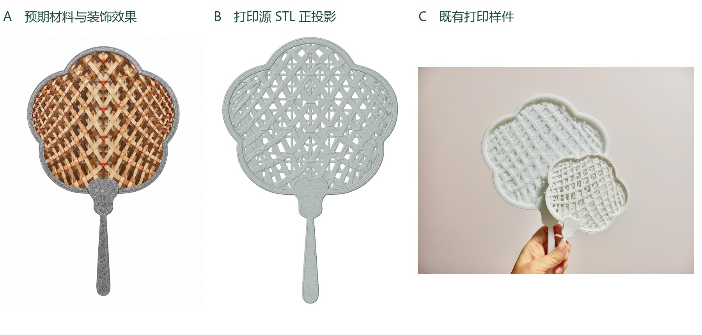
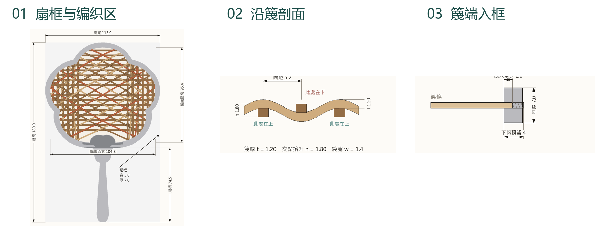
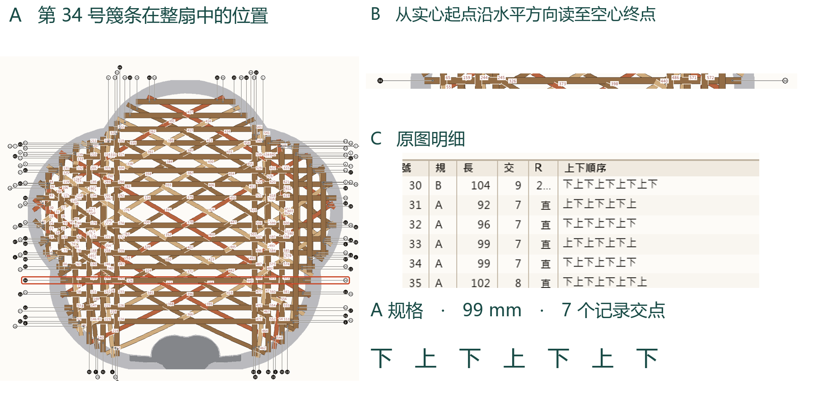
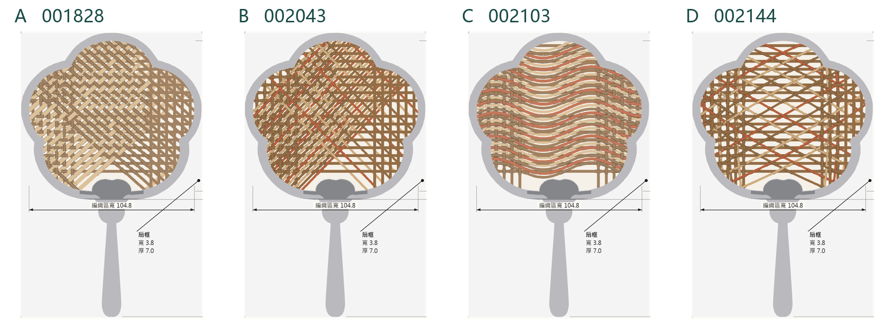

# 从旋转菱纹到逐篾工艺图：海棠形竹编团扇的参数化设计与原型研究

From a Diamond Weave to Strip-Level Fabrication Drawings: Parametric Design and Prototyping of a Haitang-Shaped Hand Fan

汪俏黎1，Atticus Sims1,*

1 澳门大学 视觉传达设计系，中国澳门
* 通讯作者：Atticus Sims，atticussims@um.edu.mo

> 摘  要 在海棠形扇框内，一根斜篾穿过何处、以哪一端为起点以及如何与其他篾条交叠，共同决定了它在图纸中的身份。围绕整体纹样如何转换为可定位的工艺信息，本文提出一种以有向篾条为基本单元的参数化表达方法。研究以旋转菱纹团扇的预期效果图和打印源模型说明设计意图，以海棠经纬系统生成的四份图纸比较边界内的路径组织，并沿一根带编号的篾条核对端点、材料规格与挑压明细。四组方案在相同标称尺寸下分别包含58至67根篾条和128至282个系统记录交点。两组方案的估算下料总长均为5.72 m，记录交点数相差152个。个案中的34号篾条可由同号两端定位，并对应到99 mm下料长度及七项有向挑压记录。打印源STL的正投影与实体照片展示了目标纹样的几何实现，另行解析的参数化3MF文件则提供了具有明确单位的数字输出。研究说明，保留篾条身份可以把整体构形、局部穿插关系与材料清单联系起来。图纸在真实竹材制作中的可读性、弯曲余量和现场调整仍待试编研究。 关键词：参数化设计；竹编团扇；编织纹样；工艺图；增材制造原型

> Abstract A woven pattern shows where strips meet, but a drawing intended for making must also specify which strip to follow, where to start and how to read successive crossings. This study develops a strip-based representation for a hand fan with a fixed, lobed frame. A target rendering and the STL used for physical prototyping document the design intent. Four drawings generated in Haitang Weave Lab provide cases for comparing strip layouts, and a worked example traces one strip from its endpoints to its material specification and over–under schedule. At the same nominal fan dimensions, the four cases contain 58–67 strips and 128–282 reported crossings. Two cases share an estimated cutting length of 5.72 m but differ by 152 reported crossings. In one drawing, strip 34 maps to a cutting length of 99 mm and a seven-entry sequence. An orthographic projection of the print-source STL, photographs of the prototypes and a separately inspected 3MF export document different stages of the design. The results establish what can be traced across the drawings. The interpretation and execution of these instructions with natural bamboo remain questions for future fabrication trials. Keywords: Parametric design · Bamboo weaving · Hand fan · Fabrication drawing · Physical prototype

## 1  引  言

旋转菱纹团扇的视觉特征来自两组尺度。远看，明暗相间的斜带在花瓣状轮廓内聚成菱形；近看，一根浅色条带会在数个深色交叉位置依次显露或被遮挡。目标效果模拟图还包含红色交点装饰及银灰色框柄（图1A）。色彩有助于辨认纹样，却没有给出某根篾条的两端位置、裁切长度和完整挑压次序。如果仅保存整扇图像，后续调整密度或方向时，这些信息需要重新建立。

问题在有限边界上尤其明显。同一组平行篾条经过不同的花瓣边缘，会被截成不同长度；两根篾条即使颜色、宽度相同，也可能具有不同的起端和交叉次数。面向设计交接，条带因而同时具有空间身份和材料身份。前者由路径与端点确定，后者由规格及下料量描述。数字工具需要说明，两种身份如何回到同一根篾。

本文考察两个问题。第一，锁定扇框后，如何通过路径族组织扇面，使不同方案可以在共同的边界条件下比较？第二，如何把局部挑压、端点与材料规格组织为可从整扇检索到逐篾条目的图纸？为此，本文以一个海棠形团扇设计项目为案例，连接预期效果、打印原型与参数化制图三类材料。研究贡献是给出有向篾条、编号端点和逐篾明细之间的表达关系，并以可复查的案例说明其作用和局限。

图 1 旋转菱纹团扇的设计目标、打印源模型与实体样件。A 为预期实物效果模拟图；B 由作者提供的打印源 STL 沿厚度方向作正投影；C 为作者拍摄的既有打印样件。各图独立缩放。A 中的竹色、红色细节及框柄质感属于预期外观。

## 2  相关研究

### 2.1  从纹样单元到有边界的条带

Liu 从26份双向竹编图谱出发，以12种代表纹样研究基本组织、对称操作、母题嵌入与空间组合[1]。该研究表明，局部挑压规律可以通过可重复的规则表达。将规则用于具体器物时，还会发生从单元到构件的变化：周期纹样上的同类位置，被器物轮廓裁切后会产生不同的起终点。对团扇制图而言，规则回答“怎样重复”，单篾记录则要回答“这一根从哪里开始、在何处结束”。二者共同决定一个图案能否展开为器物级的明细。

Ren 等以编织拓扑和目标曲面反求平面曲带，并通过平衡形态与实体样件考察其成形结果[2]。Shinohara 与 Chan 把籠目竹编转化为可组合的网格类型，并在足尺建造中观察竹材截面和实际交织位置的变化[3]。Y. Liu 等进一步把编织路径生成与机器人末端执行器结合，将材料预处理和双曲面上的执行纳入同一研究[4]。这些工作的评价对象分别落在曲带形态、材料成形和机械执行上。海棠团扇所处理的是另一项具体任务：当对象在有界平面内反复变化时，怎样保留每根条带可供制图的身份。

### 2.2  打印构件与手工编织的证据

Zoran 在混合篮具中利用打印骨架引导手工织入材料，骨架规定路径，纤维在装配中形成最终形态[5]。Gupta 与 Shende 通过改变打印网格的经向组合、织入竹篾并对混合样片定形，观察了打印结构与真实竹条之间的关系[6]。二者为本研究提供了重要参照：打印出一体化的交叠几何，只能直接证明该几何曾被实体化。逐根穿编还涉及先后顺序、回弹、摩擦及收边。为此，本文分别报告模型、打印物与工艺图的观察结果。

### 2.3  共享图纸与工艺知识

Star 与 Griesemer 讨论了不同群体如何围绕同一可识别对象组织协作[7]。Carlile 进一步指出，即便使用同一工程表示，不同职能也会关注不同的知识与约束[8]。在工艺设计领域，Suib 等借助设计干预考察了设计师与工艺实践者如何交换知识[9]。Guo 与 Ahn 则指出，隐性知识的分享依赖具体工艺情境[10]。据此，本文将“共享”落实为图纸结构能够检查的命题：读者能否从一根篾的空间位置找到同号明细？是否能够再由这一行找到对应材料组？实际协作效果需要另行观察。

表 1 最接近的研究与本文的证据对象

| 研究 | 基本对象 | 评价或观察对象 | 与本文的关系 |
| --- | --- | --- | --- |
| Liu[1] | 双向组织单元 | 图谱与重建纹样 | 本文进一步处理开口裁切后的单根路径 |
| Ren 等[2] | 平面曲带与拓扑 | 平衡形态、模型 | 本文的输出重点为图纸与逐篾记录 |
| Shinohara、Chan[3] | 三向竹编网格 | 足尺竹构件 | 材料偏差需实作检验 |
| Gupta、Shende[6] | 打印网格与竹篾 | 手工混合样片 | 打印件与天然竹材分别取证 |
| 本文 | 有向篾条与固定扇框 | 四图、一条追踪、三维文件及照片 | 核对记录及其表达范围 |

## 3  研究材料与方法

### 3.1  案例材料及分析单位

本文采用设计系统案例研究。在产品层，以旋转菱纹团扇效果模拟图描述目标形态，使用作者确认为打印实物源文件的STL核对几何，以两件白色打印样件的合照记录成品可见特征。在系统层，考察海棠经纬 Windows 版本中母版开口、纹样路径与条带网格的实现，检查四份工艺图和一份参数化3MF。产品层与系统层共同呈现同一项目的设计过程，但四份工艺图分别对应哪一件打印样件，现有记录尚不能确定。

图纸分析采用三个嵌套单位。整扇层记录标称尺寸、篾条总数与估算用料；材料组层记录规格和组内数量；单篾层记录编号、起终点、下料长、记录交点数与上下序列。四份工艺图以导出文件名后六位对应A至D。由于方案标识相同，编号仅作为本文的案例索引。共用母版使案例具有共同的轮廓参照，各方案的参数并未作为独立实验因素控制。

### 3.2  核对程序

首先，逐图转录编织统计区，保留交替率与长度的显示精度。其次，将材料表内的根数和分组长度分别相加，与同图总计栏比较。再次，在端点和明细都可辨认的案例D中，选取34号横篾进行有目的的单例追踪。选择标准是两端同号、方向清楚、序列完整，因而该例用于说明操作过程，不估计所有条目的正确率。最后，读取二进制STL的面片记录与3MF的单位、构建项及顶点坐标。模型的各轴跨度按最大坐标减最小坐标计算。

术语上，“记录交点”指系统图纸列入统计的交点；“交替率”沿用系统显示值；“长浮”采用图纸注明的连续三次及以上同侧。文中“下料长”均为设计估算。图纸给出的尺寸、网格坐标范围和打印实物测量属于三个不同层级，本研究仅有前两类数值。

## 4  参数化方法与工艺图生成

### 4.1  母版开口与纹样族

系统以海棠形外框限定可编织区域，框柄作为形态参照。四份图纸中，扇体标称高度180.0 mm、宽度113.9 mm，编织区宽104.8 mm、高95.4 mm。以开口为约束，系统调整篾条方向、间距、宽度及曲率。旋转菱纹、放射星纹、涟漪流动和细胞生长是界面的四个纹样选项。以其中的波状条带为例，改变横向波形会同时改变中心线和开孔；同样的间距参数用于直线族时，主要改变相邻条带之间的距离。

实现中，master_lock.py 处理母版及开口，rotating_diamond.py 和 pattern_fields.py 提供相应纹样路径，weave_ribbons.py 将中心线扩展为带状网格。路径进入开口边缘的位置决定端点和局部入框关系。原图还给出沿篾剖面、入框细节、材料规格和逐篾明细，使平面中的相交能够用条宽、条厚及高差进一步描述。图2摘取同一案例的三个尺度。

图 2 案例 D 的整扇正视、沿篾剖面与入框构造。图中标出的篾厚、交点抬升及入框预留均为该设计的制图参数。

### 4.2  沿篾排序与编号表达

将第 i 根篾的有向中心线记作 γᵢ(s)，s 从实心起点向空心终点递增。其信息可整理为一条记录 Rᵢ＝〈篾号，规格，长度，起点，终点，Sᵢ〉。Sᵢ 为沿篾读取的上下序列；序列为空时，应回到该条目检查记录交点数。该记法概括图纸所提供的信息。沿某根篾阅读的局部顺序只约定该篾如何穿过沿途记录位置；整把扇的装配顺序还涉及其他篾条是否已就位和操作空间是否充足。

系统的 layers.py 包含线段取样、空间分桶、交点识别和局部抬升逻辑。其中一条交点收集路径按篾对去重，默认设有640个交点的收集上限。同一对曲线若多次相交，几何相交次数与保留记录可能出现差异。由于图纸未带可复现其完整导出过程的独立快照，本文将图面计数用作输出描述。这个限制也影响后续制图：逐篾表若能同时列出每一步对应的交点号，就能减少仅凭标签邻近位置判断归属的歧义。

### 4.3  一根篾条如何连接纹样和明细

案例D的34号篾位于扇面下半部，方向近于水平。先在图3A找到其位置，再看图3B，左侧实心34与右侧空心34分别指向同一条带的两端。图3C中的34号条目给出A规格、下料长99 mm、7个记录交点。按起点读取，顺序依次为下、上、下、上、下、上、下。由规格代号返回材料表，可知本组为1.8 × 1.2 mm的碳化篾，这一方案共需28根该规格篾条。

图 3 34号篾的跨表追踪。红框由本文添加。B 为同号两端的图面放大，C 为原明细及第34行转录。局部附近还存在其他篾条的交点标记。

这种追踪包含两次不同的对应。第一次以篾号为键，将图中的一条路径与明细中的一行关联；第二次以规格为键，将这一行与材料组关联。34号条目中七个序列项与该行的交点数相符。这里可以复核的是条目内部数量以及两端标识，七个位置的几何高度和每一处竹材的接触状态仍有待独立校核。

## 5  结果

### 5.1  相同轮廓下的路径组织

图4按相同图面尺度并列四个正视图。A的斜向条带在中央形成较密交织；B出现更多色宽组合；C以连续波形形成大面积横向组织；D将较大的菱形开孔保留在中央。这里使用可从图纸辨认的构形描述。界面纹样名称和A至D的图纸序号分别取自不同材料，缺少参数快照时不据外观作逐项配对。

图 4 四组工艺图的正视输出。A至D依次对应文件后缀001828、002043、002103和002144。

表 2 工艺图输出的描述性比较

| 案例 | 篾条数 | 规格数 | 记录交点 | 交替率 | 长浮篾数 | 下料总长/m |
| --- | --- | --- | --- | --- | --- | --- |
| A | 66 | 3 | 280 | 100.0% | 0 | 5.72 |
| B | 67 | 7 | 250 | 97.3% | 0 | 6.31 |
| C | 62 | 4 | 128 | 100.0% | 0 | 5.72 |
| D | 58 | 4 | 282 | 97.1% | 0 | 5.14 |

A与C的估算下料长度相同，但A的记录交点比C多152个，约为C的2.19倍。D使用的篾条最少，图纸报告的交点最多。B的材料规格数与估算用料均最高。这说明在本组设计中，用料长度、规格分组和交点组织描述了不同属性。只凭其中一项给方案排序，会忽略另一些设计差异。四份图的长浮篾数均为零，B和D的交替率低于100%。连续两次同侧可以打断严格交替而尚未达到三次长浮阈值；各图中偏离严格交替的具体成因仍需回到原始交点记录。

### 5.2  材料明细的图内复算

表 3 由各材料组显示值复算的根数与长度

| 案例 | 各材料组根数 | 根数合计 | 分组长度之和/m | 图面总长/m | 差值/m¹ |
| --- | --- | --- | --- | --- | --- |
| A | 28 + 19 + 19 | 66 | 5.72 | 5.72 | 0.00 |
| B | 28 + 11 + 10 + 6 + 5 + 4 + 3 | 67 | 6.32 | 6.31 | +0.01 |
| C | 28 + 12 + 11 + 11 | 62 | 5.72 | 5.72 | 0.00 |
| D | 28 + 12 + 10 + 8 | 58 | 5.14 | 5.14 | 0.00 |

¹ 差值为“分组显示值之和减去统计栏显示值”。各组长度在图纸上保留两位小数。

四组材料根数之和均与本图篾条总数相符。长度方面，A、C、D的分组显示值相加后与总计相符。B由2.36、1.11、1.03、0.61、0.51、0.41和0.29 m相加得到6.32 m，比总计栏多0.01 m。若分组和总计分别由更高精度的底层数值舍入，小差异在算术上可能出现；目前没有未舍入明细可将原因确定为舍入。该例说明，核对一份工艺图时应同时保存显示精度和分组规则。

### 5.3  打印源模型、实体形态与参数化导出

作者确认为打印实物源文件的《旋转菱纹竹编手持扇-5》是二进制STL。解析得到1,875,474个三角面，文件长93,773,784字节，与二进制STL的记录长度84＋50×面数吻合。X、Y、Z三个方向的坐标跨度约为0.64756、0.04927和0.98097个文件单位。STL未记录物理单位，沿较薄的Y轴投影可以观察扇面外轮廓、扇柄以及交织结构；这些坐标不用于反推实际打印尺寸或缩放比例。

回到图1，目标效果中的菱形开孔和花瓣轮廓可在打印源网格的正投影中辨认，在白色打印件上也可观察到相应的形态特征。模拟图中的深浅竹色、红色局部装饰和具有金属质感的框柄提供的是预期外观。单色样件记录了几何形态的实体化，并允许观察边缘、开孔及条带重叠。照片中的两个样件呈现出不同的外观尺度和表面细节。由于缺少各自的切片记录、材料与实测数据，本文不据两者的视觉差异评价精度、强度或打印质量。

独立提供的 fan_parametric.3mf 则明确将单位声明为毫米。其构建项引用一个名为 haitang_fan 的对象，包括81,533个顶点和165,626个三角面；坐标范围为114.36 × 180.36 × 7.00 mm。该文件说明系统输出可以具有明确的网格与计量单位。STL是本例实物打印源，3MF是另行考察的参数化输出，两份文件在研究记录中分别标识。

## 6  讨论

### 6.1  设计表达的贡献

目标效果图保留了明暗交错的视觉节奏，也提示了材料与装饰的选择。它所采用的颜色具有多种含义：浅深色可以强化纹样，也可以对应材料组。当颜色同时承担审美与分类功能，使用颜色来指认一根篾会产生歧义。本文以独立篾号和有方向的两端标记保留单根路径身份，颜色因而仍可用作造型变量。34号篾的个案表明，同一条带可以先按空间位置查找，再按材料规格统计。

文献中的边界对象概念有助于解释为什么有必要保留两种读取方向[7–9]。设计者可能需要判断一组开孔是否连续，备料人员更关心某组条带的数量和长度。工艺图把这两种问题放在同一方案内，并提供从一组数据回到另一组的路径。已有证据支持这种信息组织方式；要知道它是否缩短沟通时间，还需记录不同读者如何使用图纸。

### 6.2  形态原型与真实竹材之间

将预期效果、STL与照片并置，可以辨认哪些目标已经落实为几何，哪些仍是材料设想。这种对应尤其适合镂空编织设计：打印机可将已赋予上下高度的条带作为整体成形，手艺人则要在部分结构已成形的条件下，把一根有厚度、刚度和回弹的篾条送入目标位置。混合篮具和混合竹编研究通过真实材料的织入观察了后一个过程[5，6]。本文的实物证据止于几何原型，图纸标注的最小弯曲半径15 mm仍是待校准的设计值。

### 6.3  局限与未来研究

四个案例共用一种海棠形边界，能够展示局部路径变化，却无法估计方法对其他器形的普适性。部分交点标签在密集区域靠得很近，单篾追踪只覆盖一个端点清楚的案例，且系统包和工艺图的精确生成版本尚未逐项配准。未来可以保存每份图的参数快照、完整交点表和网格标识，用独立线段求交检验多次交叉，再评估逐篾条目与三维几何的一致程度。

材料层面的后续研究可选择一个开孔较大的菱形区和一个弯曲波形区，邀请手艺人据图试编。记录首次需要澄清的位置、难以弯折或穿入的步骤、失败样件及其修正，并以篾号和交点号回写。这样能够区分几何规则遗漏、图面表达歧义与真实竹材约束，也使隐性知识研究所强调的情境性[10]在此项目中获得可观察的对象。

## 7  结  论

本文以海棠形团扇为对象，建立了从目标纹样、受边界约束的篾条路径到逐篾工艺图的表达方法。四个方案展示出相同用料估算与不同交织组织并存的情形；一根篾条的定向回查则把整体图像中的位置连接到规格、下料长度和挑压记录。打印源模型和实物照片为其中的几何形态提供了直接参照。对这一阶段的设计而言，最可检验的成果是可按编号读取、跨表复算并明确标注证据边界的图纸。后续竹材试编将检验这些数字记录在实际制作中还需要哪些修正。

## 参考文献（References）

[1] Liu C-H. Design principles and generative computational modeling of two-directional bamboo weaving patterns. Advances in Bamboo Science, 2026, 17, 100264. DOI 10.1016/j.bamboo.2026.100264.

[2] Ren Y, Panetta J, Chen T, et al. 3D Weaving with Curved Ribbons. ACM Transactions on Graphics, 2021. DOI 10.1145/3450626.3459788.

[3] Shinohara H, Chan T H P. A computation design method for architectural artifacts adapted from traditional Kagome bamboo basketry techniques. Frontiers of Architectural Research, 2024, 13(2), 249–264. DOI 10.1016/j.foar.2023.11.007.

[4] Liu Y, Wang S, Makvandi M, et al. Robotic bamboo weaving with computational path generation and adaptive end-effector design. Automation in Construction, 2026, 106824. DOI 10.1016/j.autcon.2026.106824.

[5] Zoran A. Hybrid Basketry: Interweaving Digital Practice within Contemporary Craft. Leonardo, 2013, 46(4), 324–331.

[6] Gupta S, Shende A. Crafting the In-Between: Weaving with Hybrid Bamboo and 3D Printed Mesh as Regenerative Practice. IASDR 2025. DOI 10.21606/iasdr.2025.1135.

[7] Star S L, Griesemer J R. Institutional ecology, “translations” and boundary objects: Amateurs and professionals in Berkeley’s Museum of Vertebrate Zoology, 1907–39. Social Studies of Science, 1989, 19(3), 387–420.

[8] Carlile P R. A pragmatic view of knowledge and boundaries: Boundary objects in new product development. Organization Science, 2002, 13(4), 442–455.

[9] Suib S S S B, Van Engelen J M L, Crul M R M. Enhancing knowledge exchange and collaboration between craftspeople and designers using the concept of boundary objects. International Journal of Design, 2020, 14(1), 113–133.

[10] Guo J, Ahn B. Tacit knowledge sharing for enhancing the sustainability of intangible cultural heritage (ICH) crafts: A perspective from artisans and academics under craft–design collaboration. Sustainability, 2023, 15, 14955. DOI 10.3390/su152014955.
