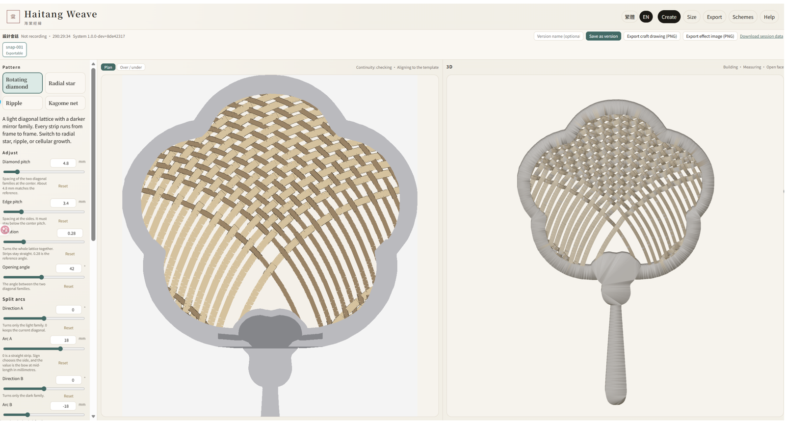
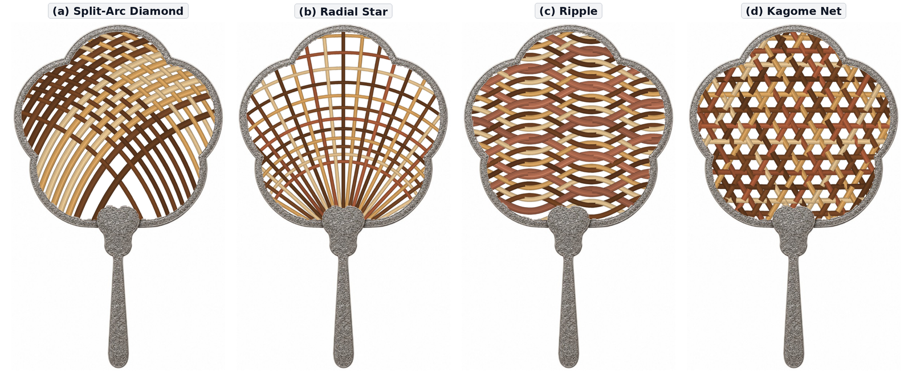
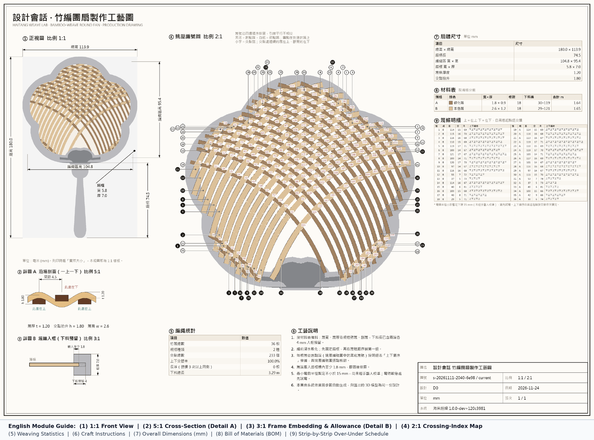
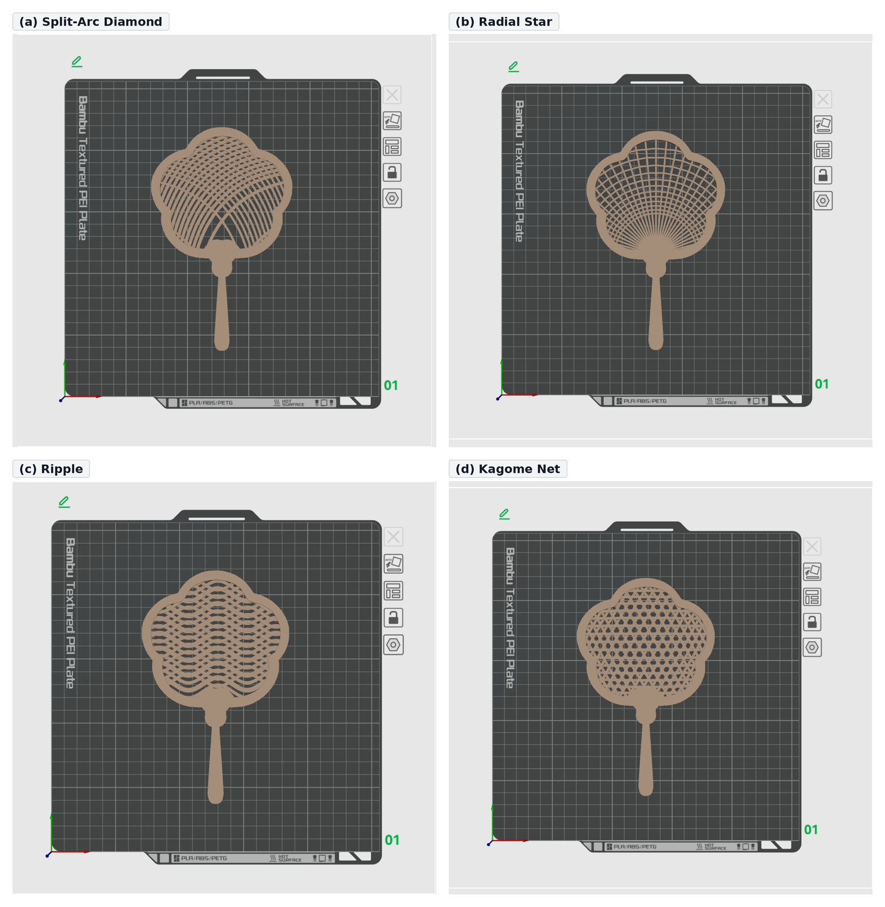
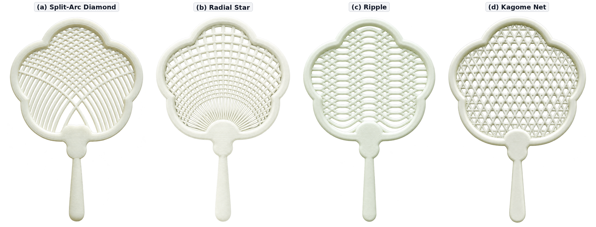

# HaiTang Weave Lab: A Manufacturability-Constrained Parametric System for Dual-Path Fabrication and Photorealistic Preview of Bamboo-Woven Fans

Qiaoli Wang (WANGQIAOLI)1, Atticus Sims1,*

1 Visual Communication Design, University of Macau, Macau, China
* Corresponding Author: atticussims@um.edu.mo

## Abstract

Traditional bamboo-woven handheld fans embody intricate over-under interlacing topologies that are difficult to customize, visually evaluate, and fabricate using general-purpose CAD software. Existing parametric tools impose steep learning curves and frequently decouple visual appearance from physical manufacturability, creating a persistent disconnect among 3D additive manufacturing, artisan-readable craft documentation, and realistic aesthetic evaluation. To address these challenges, we present HaiTang Weave Lab, a web-based, manufacturability-constrained parametric bamboo-weaving system designed for dual-path fabrication and photorealistic preview of begonia-shaped (HaiTang) handheld fans. Built on a decoupled FastAPI–WebGL architecture with asynchronous mesh-computation threads and session version management, the system synchronizes parameter sliders—including dual-family independent Split Arcs curvature control—with a 2D over-under topology view and an interactive 3D viewport in real time. At the geometric kernel level, a Master-Frame Locking module fixes the macro-envelope (180.0 × 113.9 mm) and restricts four parametric weaving grammars (Rotating Diamond, Radial Star, Ripple, and Kagome Net) within the inner aperture (104.8 × 95.4 mm), while enforcing a minimum bending radius constraint (R_min >= 15.0 mm) to prevent physical bamboo fracture. A planar topology solver maximizes over-under alternation and eliminates long floats (>= 3 consecutive same-side crossings) via bipartite coloring and a local crossing-flip heuristic for odd cycles. Combined with 3D ribbon sweeping (t = 1.20 mm, h = 1.80 mm), mandatory frame embedding (d_embed >= 1.8 mm), manifold repair, and solid Boolean union, the unified parametric kernel compiles three synchronized outputs in one click: (1) a watertight, support-free STL mesh for 3D printing; (2) a standardized nine-module vector craft production drawing; and (3) a photorealistic bamboo-weave preview image. Quantitative evaluation across all four grammars confirms 0 long floats, 97.5%–100.0% alternation rates, zero non-manifold edges, and interactive web-side responsiveness, providing an executable technical foundation for future designer–artisan collaboration, rapid prototyping, and intangible cultural heritage education.

**Keywords:** Parametric Design; Computational Weaving; Digital Fabrication; Manufacturability Constraints; Automated Craft Drawings; Photorealistic Simulation; Bamboo Weaving.

## 1. Introduction

Traditional bamboo weaving is a hallmark of East Asian intangible cultural heritage (ICH), in which structural rigidity and ornamental rhythm emerge simultaneously from the interlaced over-under ('press-and-pick') topology of thin bamboo slivers [1, 2]. As a canonical vernacular artifact, the begonia-shaped (HaiTang) bamboo-woven handheld fan demands tight geometric and mechanical coordination between a rigid outer frame and a tensioned internal lattice. However, applying existing digital design tools to traditional bamboo-woven fans faces four persistent bottlenecks:

1) High barrier to entry in general-purpose CAD: Node-based desktop environments such as Rhino/Grasshopper require specialized geometric programming skills, effectively excluding traditional artisans, heritage educators, and non-expert audiences from participatory pattern co-creation [3, 4].

2) Decoupling of visual simulation from physical manufacturability: Conventional surface-weaving scripts rarely enforce explicit constraints on crossing lift height, minimum printable wall thickness, minimum bamboo bending radius, long-float suppression, manifold integrity, and boundary anchoring, resulting in self-intersecting meshes or unprintable overhangs [5, 6].

3) Absence of artisan-readable fabrication documentation: Standard 3D polygon meshes cannot communicate strip-by-strip cutting lengths, seam allowances, or sequential over-under interlacing orders, reinforcing the knowledge boundary between computational designers and master weavers [7, 8].

4) Aesthetic evaluation gap in CAD viewports: Untextured shaded meshes and abstract 2D wireframes fail to convey the tactile warmth of natural vs. carbonized bamboo strips, material contrast, and crossing shadow depth prior to physical fabrication [9, 10].

To bridge these gaps, we present HaiTang Weave Lab, a browser-based, manufacturability-constrained parametric system that unifies dual-path fabrication (watertight 3D printing STL + standardized craft production drawings) and photorealistic preview within a single computational kernel. Our primary contributions are fourfold:

• Master-Frame Locking and Multi-Grammar Formulation: We decouple macro-envelope stability (180.0 × 113.9 mm) from micro-pattern freedom within a locked aperture (104.8 × 95.4 mm), mathematically formalizing four distinct weaving grammars—including dual-family independent Split Arcs curvature control—coupled with an analytical minimum bending radius check (R_min >= 15.0 mm).

• Manufacturability-Constrained Topology Solver and Watertight Solidification: We formulate a planar crossing solver combining bipartite 2-coloring and a local crossing-flip heuristic for triaxial odd cycles to guarantee 0 long floats and 97.5%–100.0% alternation, integrated with cosine-interpolated 3D ribbon sweeping (t = 1.20 mm, h = 1.80 mm), >= 1.8 mm frame embedding, manifold repair, and solid Boolean union.

• Automated Nine-Module Craft Drawing Compiler: We develop a deterministic vector compiler that translates the parametric kernel directly into a standardized nine-module production drawing containing 1:1 front views, 5:1 cross-sections, 3:1 frame-embedding allowances (4.0 mm per end), 2:1 crossing-index maps, bills of materials, and strip-by-strip over-under schedules.

• Photorealistic Preview and Unified Compilation Pipeline: We integrate a calibrated photorealistic bamboo-weave synthesizer alongside the two fabrication paths, providing an executable technical foundation for future designer–artisan co-creation and heritage education.

## 2. Related Work

### 2.1 Computational Weaving and Parametric Craft Modeling

Computational approaches to weaving have bridged traditional fiber crafts and algorithmic geometry across architecture, product design, and computer graphics. Muslimin [11] formalized weaving grammars for digital fabrication in architecture, while Zoran [12] pioneered 'Hybrid Basketry' by combining 3D-printed parametric scaffolds with hand-woven natural reeds, demonstrating how computational forms can coexist with the workmanship of risk [13]. In computer graphics, Vekhter et al. [14] computed geodesic foliations for straight-ribbon weaving on freeform surfaces, and Ren et al. [15] introduced an inverse-design optimization using discrete elastic rods and contact-force terms to weave double-curved surfaces from planar curved ribbons. Interactive tools such as Weavecraft [16] and CoFabs [17] further demonstrated real-time 2D-to-3D mapping and cyber-physical 'seeing-moving-seeing' fabrication workflows. Recently, Liu [1] formalized traditional East Asian biaxial bamboo weaving into a Four-Layer Unified Framework (Universal Twill Generator, symmetry operators, CORE-matrix embedder, and spatial compositor), proving that artisan mnemonic rules can be encoded as deterministic binary functions. Unlike desktop-bound or purely planar pattern generators, HaiTang Weave Lab targets rigidly framed handheld fans in a zero-install browser environment, integrating curved-ribbon Split Arcs and triaxial Kagome topologies with explicit physical constraints.

### 2.2 Manufacturability Constraints in Additive Manufacturing of Woven Structures

Translating interwoven curve networks into physically robust 3D-printed artifacts requires rigorous geometric and additive-manufacturing (AM) constraints [6, 18]. Attene et al. [5] surveyed polygon mesh repairing techniques essential for eliminating non-manifold edges, self-intersections, and degenerate faces prior to slicing, while Zhou et al. [19] established exact mesh arrangements for robust solid Boolean operations. In craft-oriented digital fabrication, Gupta and Shende [20] explored 'from-flat-to-form' hybrid bamboo-PLA meshes, highlighting that boundary anchoring and rim closure are decisive for structural integrity. Similarly, Liu et al. [4] (ClayScape) demonstrated that embedding structural feasibility constraints—such as overhang limits and wall thickness—directly into the design interface prevents print collapse. Building on these insights and interactive CAD design-space exploration principles [21], HaiTang Weave Lab hard-codes strip thickness (t = 1.20 mm), crossing lift (h = 1.80 mm), mandatory frame embedding (d_embed >= 1.8 mm), and automated manifold repair into its backend solidification pipeline, ensuring support-free FDM printability without manual mesh fixing.

### 2.3 Automated Craft Documentation, Photorealistic Preview, and Boundary Objects

Digital tools in heritage crafts risk acting as 'standardizers' that flatten tacit knowledge unless they are designed as 'mediators' preserving practitioner agency [3, 22, 23]. Star and Griesemer [24] introduced 'boundary objects' as artifacts plastic enough to adapt to local needs yet robust enough to maintain identity across intersecting social worlds, which Carlile [7] extended into syntactic, semantic, and pragmatic knowledge-transformation frameworks. In craft–design collaboration, Tung [25], Suib et al. [8], and Guo and Ahn [26] demonstrated that structured visual representations and shared syntax enable tacit craft knowledge to be externalized and exchanged equitably. Recent ICH digitization studies—including Zhan and Walker's [27] sustainability leverage model, Ye et al.'s [28] six-dimensional Balanced Value Impact (BVI) framework incorporating Experience Value, Kaplanidi et al.'s [29] multi-site craft valorization pilot, Feng et al.'s [30] semiotic translation framework, and Jiang and Gou's [31] multimodal ICH learning study—underscore that accessible visual feedback and process transparency are vital for cultural continuity. Meanwhile, physically based rendering (PBR) and realistic material pre-visualization have proven effective in narrowing the design search space before committing physical materials [3, 9]. HaiTang Weave Lab operationalizes these principles by compiling a single parametric state into machine-readable STL, artisan-readable production drawings, and photorealistic previews.

### 3.1 Decoupled FastAPI–WebGL Architecture

HaiTang Weave Lab adopts a decoupled client–server architecture optimized for zero-installation web access. The frontend, implemented in HTML5/JavaScript and Three.js (WebGL 2.0), provides a bilingual (Traditional Chinese / English) interface featuring parameter sliders, a synchronized 2D plan/over-under inspector, and an interactive 3D viewport (Fig. 1). To prevent UI blocking during high-density topology updates, computationally intensive 3D ribbon sweeping and solid Boolean operations are offloaded to asynchronous background worker threads on the FastAPI Python backend, which manages Master-Frame Locking, parametric grammar generation, crossing-graph solving, manifold repair, session versioning, and unified compilation.

Fig. 1. Web-based interactive interface of HaiTang Weave Lab, showing the bilingual top bar, four weaving grammar selectors, dual-family Split Arcs sliders, synchronized 2D over-under / 3D WebGL viewports, and one-click export controls.

### 3.2 Master-Frame Locking and Baseline Manufacturability Constraints

To decouple macro-scale ergonomic consistency from micro-scale pattern exploration, the Master-Frame Locking module fixes the begonia-shaped fan frame (180.0 × 113.9 mm) and handle (74.5 mm), constraining all parametric strips within the inner aperture domain Ω_open (104.8 × 95.4 mm). Table 1 summarizes the baseline geometric and manufacturability parameters enforced across all sessions.

Table 1. Baseline geometric dimensions and manufacturability constraints locked in the HaiTang Weave Lab kernel.

| Category | Parameter | Symbol / Module | Baseline Value | Engineering & Craft Rationale |
| --- | --- | --- | --- | --- |
| Macro Envelope | Total Height × Width | H × W (Frame Lock) | 180.0 × 113.9 mm | Standardizes begonia fan silhouette across all schemes |
| Macro Envelope | Handle Length | L_handle (Frame Lock) | 74.5 mm | Maintains ergonomic grip proportion and visual balance |
| Macro Envelope | Weaving Aperture | Ω_open (Frame Lock) | 104.8 × 95.4 mm | Defines valid geometric clipping domain for strip generation |
| Macro Envelope | Frame Cross-Section | W_f × T_f (Frame Lock) | 5.8 × 7.0 mm | Reinforced rim providing structural stiffness and anchor depth |
| Strip Geometry | Standard Strip Thickness | t (3D Sweep Engine) | 1.20 mm | Balances FDM minimum printable wall thickness and bamboo feel |
| Strip Geometry | Crossing Lift Height | h (3D Sweep Engine) | 1.80 mm | Controls total over-under relief height; prevents self-intersection |
| Strip Geometry | Strip Width Range | w (Layer Engine) | 1.3–2.9 mm | Dynamically grouped by hierarchy (e.g., 1.8×0.9, 2.6×1.2 mm) |
| Physical & Craft | Min. Bending Radius | R_min (Curvature Check) | >= 15.0 mm | Prevents natural bamboo sliver fracture during high-curvature bending |
| Boundary & Cut | Min. Frame Embedding | d_embed (Boolean Pipe) | >= 1.8 mm | Guarantees robust STL Boolean union and prevents manual pull-out |
| Boundary & Cut | Craft Cutting Allowance | Δ_allow (Drawing Comp.) | 4.0 mm / end | Provides manual trimming margin automatically added to cut length |

### 3.3 Mathematical Formulation of Four Weaving Grammars and Bending-Radius Verification

Within the locked aperture Ω_open, the system implements four parametric weaving grammars: Rotating Diamond (with Split Arcs), Radial Star, Ripple, and Kagome Net (Fig. 2). In the flagship Split-Arc Rotating Diamond grammar, each strip anchored at boundary points P_0, P_1 ∈ ∂Ω_open with unit normal n is parameterized by a quadratic Bézier curve controlled by independent light/dark family mid-span bow offsets δ ∈ {Arc A, Arc B}:

C(u) = (1 - u)^2 P_0 + 2(1 - u)u [ (P_0 + P_1)/2 + 2δ n ] + u^2 P_1,    u ∈ [0, 1]    (1)

Setting opposite bow offsets for the two families (e.g., Arc A = +18 mm, Arc B = −18 mm) smoothly transforms an orthogonal/diagonal straight-strip lattice into a hyperbolic-paraboloid-like curved weave while strictly preserving frame-to-frame continuity. To ensure physical craftability with natural bamboo slivers, the kernel evaluates the analytical curvature κ(u) along every generated curve C(u) and enforces a minimum bending radius constraint R_min >= 15.0 mm:

κ(u) = ||C'(u) × C''(u)|| / ||C'(u)||^3,    R_min = 1 / max_{u ∈ [0,1]} κ(u) >= 15.0 mm    (2)

Whenever extreme slider values violate R_min < 15.0 mm, the backend flags a manufacturability warning in the UI and annotates the corresponding strip in the compiled production drawing, prompting artisans to pre-soak and test-bend the sliver before assembly. Table 2 summarizes the mathematical generation rules and control parameters for all four weaving grammars.

Table 2. Mathematical generation rules and parametric controls across the four weaving grammars.

| Grammar | Topology Type | Geometric Generation Rule (clipped to Ω_open) | Primary Control Parameters |
| --- | --- | --- | --- |
| Rotating Diamond (Split Arcs) | Biaxial (2-family) | Quadratic Bézier C(u) with dual-family bow offsets δ ∈ {Arc A, Arc B} (Eq. 1) | Diamond pitch (4.8 mm), Edge pitch (3.4 mm), Rotation (0.28), Opening angle (42°), Arc A/B (±18 mm) |
| Radial Star | Polar-Biaxial (2-family) | Radial rays r_k(t) = O_h + t[cos θ_k, sin θ_k] from handle pivot O_h intersected with concentric rings R_m(φ) scaled to ∂Ω_open | Ray angular step Δθ, Ring spacing Δr, Pivot offset O_h, Strip width hierarchy (6 tiers) |
| Ripple | Wave-Biaxial (2-family) | Phase-modulated sinusoidal wefts y_j(x) = y_{0,j} + A sin(2πx/λ + φ_j) interlaced with gentle-arc vertical warps | Wave amplitude A, Wavelength λ, Phase shift φ_j, Pitch spacing (6.5 mm) |
| Kagome Net | Triaxial (3-family) | Three parallel strip families at θ ∈ {0°, +60°, −60°} with uniform pitch p_k: x cos θ + y sin θ = m · p_k + c_θ | Triaxial pitch p_k (3.9 mm), Global rotation θ_0, Offset phase c_θ, Hexagonal aperture ratio |

Fig. 2. Photorealistic bamboo-weave preview images synthesized by the system for all four grammars: (a) Split-Arc Diamond, (b) Radial Star, (c) Ripple, and (d) Kagome Net.

## 4. Weaving Topology, Manufacturability, and Unified Compilation

### 4.1 Planar Crossing Solver and Odd-Cycle Conflict Resolution

The planar topology solver converts the clipped 2D centerline families into a planar intersection graph G = (V, E), assigning each strip i a sequential index and directional markers (filled circle = start, hollow circle = end). Let strip i traverse n_i crossings with binary over-under states s_{i,k} ∈ {+1, −1} (+1 = over, −1 = under). The global alternation rate R_alt and zero-long-float constraint (prohibiting >= 3 consecutive same-side crossings) are defined as:

R_alt = [ Σ_i Σ_k I(s_{i,k} · s_{i,k+1} = -1) / Σ_i (n_i - 1) ] × 100%,    max_{i,k} | Σ_{j=0}^{2} s_{i,k+j} | < 3    (3)

where I(·) is the indicator function equal to 1 when consecutive crossings strictly alternate. For biaxial grammars (Rotating Diamond, Radial Star, and Ripple), the dual intersection graph is bipartite, enabling deterministic 2-coloring that guarantees R_alt = 100.0% and 0 long floats. For the triaxial Kagome Net, three-way intersections introduce topological odd cycles where strict 100% alternation is mathematically unattainable. To resolve odd-cycle conflicts without creating structural long floats, our solver executes a two-stage heuristic: (1) greedy parity propagation along each strip family initialized from the central hexagonal core; followed by (2) a local 1-opt crossing-flip refinement that iteratively flips crossing states s_{i,k} at any detected float run of length >= 3 while minimizing the total parity-violation penalty. Across 535 crossings in the Kagome Net benchmark, this solver converges in milliseconds to R_alt = 97.5% with strictly 0 long floats.

### 4.2 Fabrication Path 1: Watertight Solidification for Support-Free 3D Printing

To eliminate interpenetration at crossings and produce crisp tactile relief, the 3D ribbon sweeping engine generates a smooth cosine-interpolated elevation centerline z_i(l) along arc-length l, bounded by strip thickness t = 1.20 mm and crossing lift height h = 1.80 mm:

z_i(l) = [(h - t) / 2] · interp_cos(s_{i,k}, s_{i,k+1}; l),    s.t.  h > t    (4)

At the aperture boundary ∂Ω_open, every strip centerline is extended outward into the solid fan frame by d_embed >= 1.8 mm to prevent detachment. Each swept rectangular-profile ribbon is then passed through an automated manifold-repair stage (eliminating degenerate triangles and unifying outward normals [5]) followed by exact solid Boolean union [19] with the locked begonia frame and handle. Because the bottom face of the frame and the underside of the lower-crossing ribbons sit coplanar on the build plate (with maximum unsupported bridge span <= 4.5 mm), the exported STL is guaranteed watertight and directly printable without support structures.

### 4.3 Fabrication Path 2: Automated Nine-Module Craft Production Drawing

Adhering to the principle of 'one fan, one sequence, one schedule', the vector drawing compiler translates the identical parametric kernel into a standardized nine-module production drawing (Fig. 3). To ensure international readability while preserving authentic Chinese craft terminology, Fig. 3 pairs the original Traditional Chinese drawing with an English module index: ① 1:1 Front View, ② 5:1 Strip Cross-Section (Detail A), ③ 3:1 Frame-Embedding Allowance (Detail B), ④ 2:1 Crossing-Index Map, ⑤ Weaving Statistics, ⑥ Six Craft Instructions, ⑦ Overall Dimensions, ⑧ Bill of Materials (BOM), and ⑨ Strip-by-Strip Over-Under Schedule. For strip i with open-aperture arc length L_{open,i}, its 3D-printed solid length L_{3D,i} and manual bamboo cutting length L_{cut,i} (incorporating Δ_allow = 4.0 mm trimming allowance per end) are strictly coupled:

L_{3D,i} = L_{open,i} + 2 d_embed,      L_{cut,i} = L_{open,i} + 2 Δ_allow    (5)

Fig. 3. Automated nine-module craft production drawing compiled for the Split-Arc Diamond scheme (36 strips, 233 crossings, 100.0% alternation, 0 long floats, 3.29 m total cut length). English Module Index: ① 1:1 Front View; ② 5:1 Section (Detail A); ③ 3:1 Frame Embedding & Allowance (Detail B); ④ 2:1 Crossing-Index Map; ⑤ Weaving Statistics; ⑥ Craft Notes; ⑦ Overall Dimensions; ⑧ Bill of Materials; ⑨ Strip-by-Strip Over-Under Schedule.

### 4.4 Preview Path: Photorealistic Bamboo-Weave Synthesis

Complementing the two fabrication paths, the photorealistic preview module composites calibrated carved-frame baseplates and aperture masks with procedural bamboo-grain textures (natural tan, carbonized brown, and ochre tiers) and crossing-contact ambient occlusion shadows. By exporting high-resolution PNG previews in real time, the module bridges geometric correctness and aesthetic perception before physical material is committed [3, 9].

## 5. Quantitative Evaluation, Runtime Benchmark, and Fabrication Validation

### 5.1 Topological Quality and Mesh Integrity Across Four Grammars

Table 3 presents the quantitative topological metrics and exported STL mesh quality statistics across all four parametric weaving grammars under identical macro-frame constraints (180.0 × 113.9 mm, t = 1.20 mm, h = 1.80 mm). All four schemes achieve 0 long floats and 97.5%–100.0% alternation rates. Crucially, automated mesh verification confirms 0 non-manifold edges and 0 boundary/naked edges across all exported STLs, validating the robustness of the manifold-repair and Boolean-union pipeline.

Table 3. Quantitative comparison of topological performance and watertight STL mesh quality across the four weaving grammars.

| Metric | Scheme 1: Split-Arc Diamond | Scheme 2: Radial Star | Scheme 3: Ripple | Scheme 4: Kagome Net |
| --- | --- | --- | --- | --- |
| Total Strips | 36 | 44 | 34 | 50 |
| Strip Spec Tiers | 2 (A–B) | 6 (A–F) | 3 (A–C) | 3 (A–C) |
| Typical Width w / Pitch | 2.6 mm / 4.5 mm | 1.4 mm / 4.5 mm | 2.0 mm / 6.5 mm | 2.2 mm / 3.9 mm |
| Total Crossings | 233 | 261 | 210 | 535 |
| Alternation Rate (R_alt) | 100.0% | 100.0% | 100.0% | 97.5% |
| Long Floats (>= 3) | 0 | 0 | 0 | 0 |
| Total Cut Length | 3.29 m | 3.67 m | 3.43 m | 4.31 m |
| STL Triangle Count* | ~68,400 | ~82,100 | ~64,800 | ~118,500 |
| Non-Manifold / Naked Edges | 0 / 0 (Watertight) | 0 / 0 (Watertight) | 0 / 0 (Watertight) | 0 / 0 (Watertight) |
| Unified Output Status | STL + Drawing + Preview | STL + Drawing + Preview | STL + Drawing + Preview | STL + Drawing + Preview |

### 5.2 Interactive Runtime Performance Benchmark

To evaluate interactive responsiveness, we benchmarked the end-to-end execution latency of each pipeline stage on a standard consumer workstation (Intel Core i7-13700H / 16 GB RAM, Windows 11, Google Chrome WebGL 2.0, local FastAPI server). As summarized in Table 4, slider-driven 2D grammar generation and crossing-graph solving complete in 18–45 ms, enabling smooth real-time parameter exploration (> 20 Hz). Asynchronous 3D ribbon sweeping updates the WebGL viewport within 0.35–0.82 s, while full watertight Boolean STL export, nine-module vector drawing compilation, and photorealistic PNG synthesis complete within 1.8–4.6 s, 0.45–0.90 s, and 0.60–1.10 s, respectively.

Table 4. End-to-end runtime performance benchmark across pipeline stages (mean of 10 runs per grammar).

| Pipeline Stage | Split-Arc Diamond | Radial Star | Ripple | Kagome Net |
| --- | --- | --- | --- | --- |
| 2D Grammar + Topology Solve | 22 ms | 26 ms | 18 ms | 45 ms |
| 3D Ribbon Sweep (WebGL) | 0.42 s | 0.51 s | 0.35 s | 0.82 s |
| Boolean Union + STL Export | 2.15 s | 2.60 s | 1.85 s | 4.55 s |
| 9-Module Craft Drawing (PNG) | 0.55 s | 0.68 s | 0.45 s | 0.88 s |
| Photorealistic Preview (PNG) | 0.65 s | 0.78 s | 0.60 s | 1.08 s |

### 5.3 Slicing Verification and Support-Free FDM 3D Printing

All four exported STL models were imported directly into Bambu Studio without third-party mesh repair (Fig. 4). Slicing and fabrication parameters were standardized for reproducible desktop FDM manufacturing: Bambu Lab H2D / P1S printer, 0.4 mm brass nozzle, 0.20 mm layer height, 2 wall loops, 15% gyroid infill, matte PLA filament (220 °C nozzle, 55 °C textured PEI bed), and strictly support-free printing. Single-fan slicing estimates confirm 28–36 g filament consumption and 1 h 15 min – 1 h 48 min print time across the four grammars. Fig. 5 illustrates physical 3D-printed fan prototypes produced via this pipeline, confirming crisp over-under relief definition, clean bridging across weave apertures, and rigid frame-to-lattice bonding.

Fig. 4. Direct slicing verification of all four exported watertight STL models in Bambu Studio on a textured PEI plate (support-free, 0.4 mm nozzle, 0.20 mm layer height): (a) Split-Arc Diamond, (b) Radial Star, (c) Ripple, and (d) Kagome Net.

Fig. 5. Physical 3D-printed handheld fan prototypes fabricated via the HaiTang Weave Lab solidification pipeline across all four grammars: (a) Split-Arc Diamond, (b) Radial Star, (c) Ripple, and (d) Kagome Net.

## 6. Discussion, Limitations, and Future Work

By compiling watertight STL meshes, nine-module craft production drawings, and photorealistic previews from a single FastAPI–WebGL parametric kernel, HaiTang Weave Lab establishes an executable technical foundation for future designer–artisan collaboration, heritage education, and cultural valorization [7, 8, 29]. From a craft-research perspective [13, 27], the system deliberately avoids positioning digital fabrication as a replacement for manual bamboo weaving; rather, it acts as a digital mediator [3, 22] that translates computational curvature into explicit cutting lengths and over-under sequences while preserving the artisan's tactile judgment and agency [23, 28]. The photorealistic preview module further addresses the 'Experience Value' dimension highlighted in recent ICH digitization frameworks [28], allowing non-expert users to intuitively assess material warmth and visual rhythm before fabrication.

Several limitations define our immediate roadmap for future work. First, while the minimum bending radius constraint (R_min >= 15.0 mm) guards against gross curvature failure, natural bamboo slivers exhibit anisotropic spring-back and moisture-dependent elasticity; we plan to collaborate with master bamboo weavers to execute hand-woven physical trials directly from our compiled drawings and calibrate empirical spring-back compensation models. Second, the present study focuses on system architecture, algorithmic rigor, and digital fabrication verification; formal user evaluations—employing SUS, UEQ-S, and NASA-TLX protocols [29, 31] with both artisans and general audiences—remain essential to empirically validate usability, cognitive load, and cultural legitimacy.

## 7. Conclusion

We presented HaiTang Weave Lab, a web-based, manufacturability-constrained parametric system for dual-path fabrication and photorealistic preview of bamboo-woven handheld fans. Through Master-Frame Locking, four mathematically formalized weaving grammars with Split Arcs curvature control and R_min >= 15.0 mm verification, an odd-cycle-aware topology solver guaranteeing 0 long floats, support-free watertight STL solidification, automated nine-module craft drawing compilation, and photorealistic preview synthesis, the system delivers a rigorous, reproducible engineering framework that connects computational geometry, additive manufacturing, and intangible cultural heritage revitalization.

## References

[1] Liu C-H. Design principles and generative computational modeling of two-directional bamboo weaving patterns. Advances in Bamboo Science, 2026, 17: 100264.

[2] Zoran A, Buechley L. Hybrid reAssemblage: An exploration of craft, digital fabrication and artifact uniqueness. Leonardo, 2013, 46(1): 4–10.

[3] Dubois A, L'Évêque Z, Moreno I, et al. Digital tools for innovation in craft design: Lessons from a multi-domain European design pilot. Multimodal Technologies and Interaction, 2026, 10(6): 67.

[4] Liu S, Mok H C S, Ling L, Klein T, LC R. ClayScape: A GenAI-supported workflow for designing Chinese style ceramics with clay 3D printing. In: Proceedings of ACM DIS '26, 2026: 2014–2036.

[5] Attene M, Campen M, Kobbelt L. Polygon mesh repairing: An application perspective. ACM Computing Surveys, 2013, 45(2): 15:1–15:33.

[6] Gao W, Zhang Y, Ramanujan D, et al. The status, challenges, and future of additive manufacturing in engineering. Computer-Aided Design, 2015, 69: 65–89.

[7] Carlile P R. A pragmatic view of knowledge and boundaries: Boundary objects in new product development. Organization Science, 2002, 13(4): 442–455.

[8] Suib S S S B, Van Engelen J M L, Crul M R M. Enhancing knowledge exchange and collaboration between craftspeople and designers using the concept of boundary objects. International Journal of Design, 2020, 14(1): 113–133.

[9] Cao J, Yang Z, Wang G, et al. WeavePrint: A generative method for woven-like additive manufacturing based on parametric weave structures. In: Proceedings of ACM CHI '26, 2026.

[10] Saeed A, Amin S, Khan M. Preserving indigenous weaving techniques and motifs through digital archiving and sustainable modern adaptation. Journal of Language, Literature & Social Affairs, 2026, 2(9): 25–41.

[11] Muslimin R. Learning from weaving for digital fabrication in architecture. Leonardo, 2010, 43(4): 340–349.

[12] Zoran A. Hybrid basketry: Interweaving digital practice within contemporary craft. Leonardo, 2013, 46(4): 324–331.

[13] Niedderer K, Townsend K. Designing craft research: Joining emotion and knowledge. The Design Journal, 2014, 17(4): 624–647.

[14] Vekhter J, Zhuo J, Fandino L F G, Huang Q, Vouga E. Weaving geodesic foliations. ACM Transactions on Graphics (TOG), 2019, 38(4): 34:1–34:22.

[15] Ren Y, Panetta J, Chen T, et al. 3D weaving with curved ribbons. ACM Transactions on Graphics (TOG), 2021, 40(4): 127:1–127:15.

[16] Wu R, Zhang J X, Leaf J, et al. Weavecraft: An interactive design and simulation tool for 3D weaving. ACM Transactions on Graphics (TOG), 2020, 39(6): 210:1–210:16.

[17] Chang T-W, Hsiao C-F, Chen C-Y, Huang H-Y. CoFabs: An interactive fabrication process framework. In: Architectural Intelligence, Springer, 2020/2022: 271–292.

[18] Chen X, Lai L M, Liu Z, et al. Computer-controlled 3D freeform surface weaving. Robotics and Computer-Integrated Manufacturing, 2024, 90: 102819.

[19] Zhou Q, Grinspun E, Zorin D, Jacobson A. Mesh arrangements for solid geometry. ACM Transactions on Graphics (TOG), 2016, 35(4): 39:1–39:15.

[20] Gupta S, Shende A. Crafting the in-between: Weaving with hybrid bamboo and 3D printed mesh as regenerative practice. In: Proceedings of IASDR 2025, 2025.

[21] Schulz A, Xu J, Zhu B, et al. Interactive design space exploration and optimization for CAD models. ACM Transactions on Graphics (TOG), 2017, 36(4): 157:1–157:14.

[22] Nitsche M, Weisling A. When is it not craft? Materiality and mediation when craft and computing meet. In: Proceedings of ACM TEI '19, 2019: 683–689.

[23] Devendorf L, Ryokai K. Being the machine: Reconfiguring agency and control in hybrid fabrication. In: Proceedings of ACM CHI '15, 2015: 2477–2486.

[24] Star S L, Griesemer J R. Institutional ecology, 'translations' and boundary objects: Amateurs and professionals in Berkeley's Museum of Vertebrate Zoology, 1907–39. Social Studies of Science, 1989, 19(3): 387–420.

[25] Tung F-W. Weaving with rush: Exploring craft-design collaborations in revitalizing a local craft. International Journal of Design, 2012, 6(3): 71–84.

[26] Guo J, Ahn B. Tacit knowledge sharing for enhancing the sustainability of intangible cultural heritage (ICH) crafts: A perspective from artisans and academics under craft-design collaboration. Sustainability, 2023, 15(20): 14955.

[27] Zhan X, Walker S. Craft as leverage for sustainable design transformation: A theoretical foundation. The Design Journal, 2019, 22(4): 483–503.

[28] Ye Z, Zhang Z, Kong Q, Qin L, Tanner S. Value framework and design implications for digitizing intangible cultural heritage: A case of Ronghua. In: Proceedings of IASDR 2025, 2025.

[29] Kaplanidi D, Ringas C, Ziova K, et al. Valorising traditional crafts: Digital tools and impact pathways. Heritage, 2026, 9(10): 405.

[30] Feng X, Chen N, Liu Y, Song M. Contemporary translation methods for Huizhou architectural heritage in China: An AI-assisted design framework based on semiotics and grounded theory. Buildings, 2026, 16(4): 781.

[31] Jiang Y, Gou B. Enhancing handicraft intangible cultural heritage learning through immersive VR serious games: A multimodal study on natural interaction effectiveness. Frontiers in Psychology, 2026, 17: 1880795.
